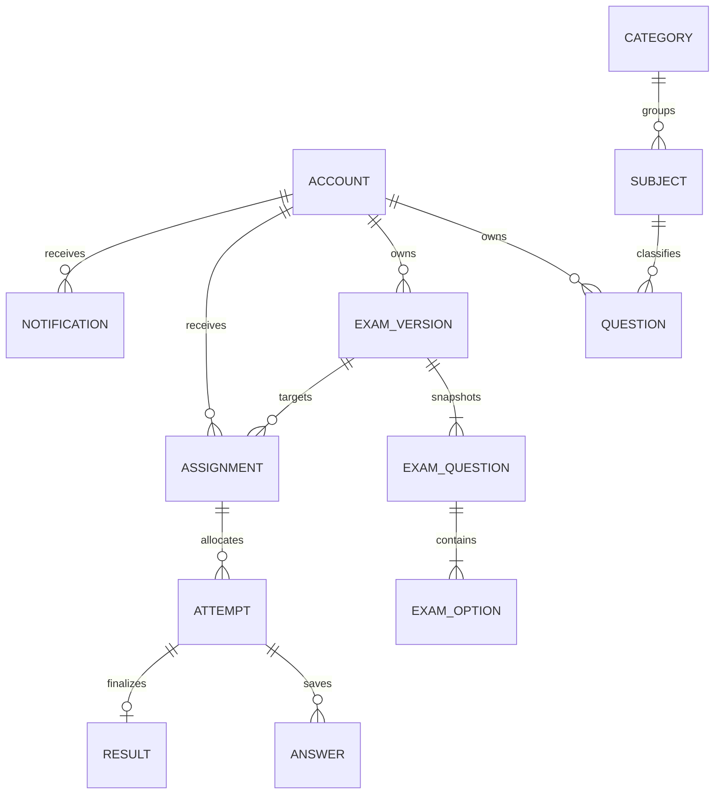

# Architecture, Data and Testability

Status: engineering design; migrations and runtime validation are separate work.
Dependencies: SRS and ACCESS_AND_STATES. No new product approvals are implied.

## Runtime boundaries

React UI → versioned JSON REST API → Spring Boot modular monolith → PostgreSQL.
Modules: identity, taxonomy, questions, exams, assignments, attempts, results,
notifications and audit. Scoring is an internal attempts/results service, not a
network hop. Controllers validate DTOs and delegate transactions; repositories
never return entities directly to the browser. JWT identity is resolved against
the account table on every request. Spring Security handles validation and RBAC.

Use Java 21 and Maven, Flyway migrations and PostgreSQL 18. Framework versions
must be pinned and dependency resolution verified in QM-007; no claim that a
version mentioned by an external documentation page is already installed.
Use Spring-managed transactions, decimal scoring and injectable `java.time.Clock`.

## Logical ER model

Drafts may temporarily have zero questions; the mandatory snapshot cardinality
applies at publish. Bank QUESTION_OPTION rows are separate from EXAM_OPTION rows.

## Tables and constraints

| Table | Keys / constraints / contents |
|---|---|
| account | UUID PK; normalized email UNIQUE, max 254; password_hash; role CHECK ADMIN/INSTRUCTOR/STUDENT; active NOT NULL; created_at UTC. No plaintext password. |
| category, subject | UUID PK; normalized name UNIQUE within parent; subject.category_id FK RESTRICT; nonblank names. |
| question, question_option | UUID PK; owner FK; subject FK; prompt; difficulty nullable; revision; options ordered uniquely per question; one correct option enforced at validated write/publish transaction. |
| exam_version | UUID PK; family_id UUID; version_number positive; UNIQUE(family_id,version_number); owner FK; state CHECK; duration_seconds 60–10800; attempt_limit 1–3; threshold NUMERIC(5,2) 0–100; shuffle flag; revision; published_at. |
| exam_question, exam_option | UUID PK; version FK; source_question_id for provenance; copied prompt/options/correctness; UNIQUE(version,position), UNIQUE(version,source_question_id); no live bank joins for taking/grading. |
| assignment | UUID PK; version FK; student FK; UNIQUE(version,student); allocated_count 0–3; lock row serializes starts. Counter increment rolls back with failed start. |
| attempt | UUID PK; assignment FK; version FK; student FK; attempt_number 1–3; started_at/deadline/finalized_at TIMESTAMPTZ; state CHECK; UNIQUE(assignment,attempt_number); partial UNIQUE(assignment) WHERE state='IN_PROGRESS'; persisted display order. |
| answer | PK(attempt,exam_question); selected exam_option nullable; nonnegative revision; updated_at. Composite FK ensures option belongs to the selected snapshot question; service ensures question belongs to attempt version. |
| result | attempt PK/FK; correct_count >= 0; total_count > 0; correct_count <= total_count; score NUMERIC(5,2) 0–100; passed; finalized_at; reason SUBMITTED/EXPIRED. No second grading row. |
| audit_event | UUID PK; actor nullable for worker; resource type/id; action; timestamp; bounded sanitized metadata; unique event_key. Append-only through application APIs. |
| outbox_event | UUID PK; event_key UNIQUE; recipient FK; event type/payload; delivery state/retries; next retry. Commit with result; worker retries delivery. |
| notification | UUID PK; recipient FK; outbox event key UNIQUE; type/resource pointer; created_at/read_at. No answer keys. |

Implemented schema note: Flyway V5 creates `exam_assignment` with a unique
`(exam_version_id, student_id)` key and a student/date index. Its row is reserved
for attempt allocation; QM-016 adds the transactional locking behavior.

Foreign keys restrict deletion of referenced records. V1 uses account activation,
exam close and bank retention rather than cascading deletion of attempt history.
Role membership and cross-table snapshot membership are service invariants tested
with integration tests; ordinary CHECK constraints cannot prove all such rules.

## Transaction implementation plan

READ COMMITTED plus explicit row locks is sufficient only if every write follows
ACCESS_AND_STATES lock order. Start locks version→assignment; the unique partial
index protects against a second active attempt as a backstop. Finalize locks an
attempt and commits result/audit/outbox once. Published content writes must be
restricted to draft-only service paths and validated with direct persistence tests.

Worker: bounded batch, `FOR UPDATE SKIP LOCKED`, transaction per attempt. Catch-up
after restart processes all overdue attempts. Request handlers also reconcile
expiry before returning active payloads. Sample injected UTC time after acquiring
the attempt lock. Production Clock cannot be controlled by an API parameter.

DEC-09 stays PENDING as a historical product-log entry; the design above is the
selected reversible mechanism, not a new human-approved timing SLA. Configure a
1-second reconciliation interval for local tests, record observed delay, and test
crash recovery with the clock fixed. Score visibility is immediate at finalization
commit; there is no claim of zero worker scheduling latency at deadline.

## Seed, reset and evidence

- Flyway creates schema only; never embeds reusable passwords or test users in
  production migrations. Test fixtures create two instructors, two students and
  one admin with synthetic `.test` addresses and runtime-generated passwords.
- Testcontainers creates a disposable PostgreSQL instance per test suite. Tests
  apply real migrations; DB semantics must not be certified using an H2 substitute.
- Reset requires an explicit test profile, a disposable database name/container,
  and scope validation. No reset endpoint or destructive production command.
- Local development bootstrap takes admin email/password from environment and is
  opt-in; the application must fail clearly rather than invent default credentials.
- Fixed/mutable test Clock advances across before/equal/after deadline without
  wall-clock sleeps. Concurrency tests use barriers, independent connections and
  bounded timeouts; verify rows and API responses after transactions complete.
- Capture versions, command, counts and outcome in worklog. Docker engine became
  reachable on 2026-11-20; the auth slice's migration/DB integration ran in QM-007.
  Remaining schema/attempt/worker integration tests are NOT_RUN.

## Technical references checked 2026-11-20

- [PostgreSQL 18 row locks](https://www.postgresql.org/docs/18/explicit-locking.html)
  describe transaction-held locks and deadlock handling.
- [PostgreSQL 18 partial indexes](https://www.postgresql.org/docs/18/indexes-partial.html)
  support conditional uniqueness for active attempts.
- [Spring Boot system requirements](https://docs.spring.io/spring-boot/4.0/system-requirements.html)
  provide Java/Maven compatibility guidance; resolve an actual pinned release
  before implementation and record any discrepancy with documentation.
